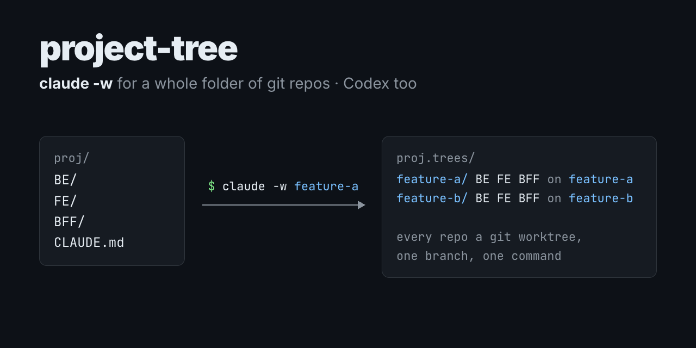
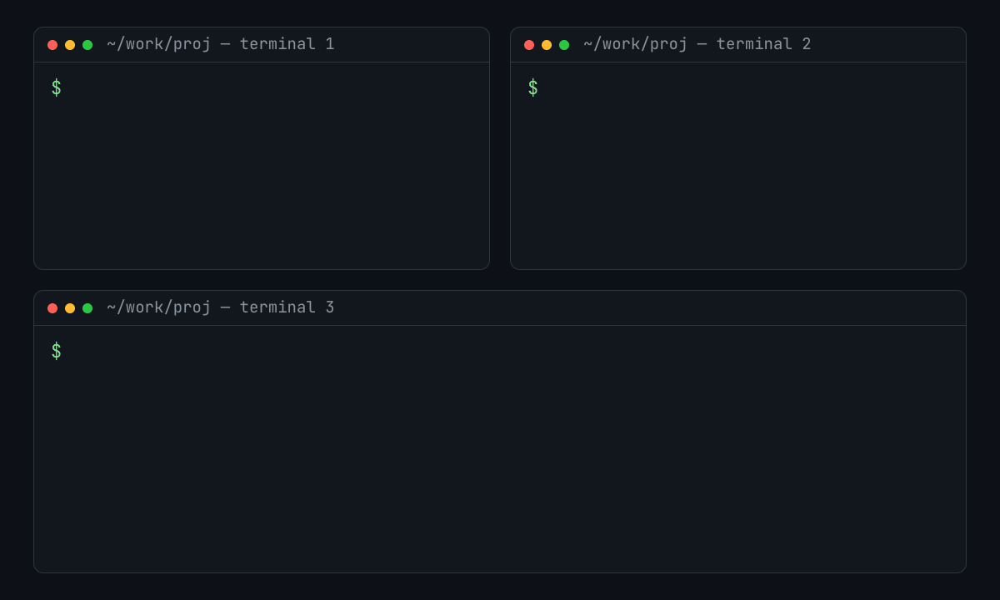

<p align="center">
  
</p>

<h1 align="center">One command. Every repo. Its own branch.</h1>

<p align="center">
  Run parallel Claude Code or Codex sessions across a folder of git repos,<br>
  the way <code>claude -w</code> already works inside a single one.
</p>

<p align="center">
  <a href="LICENSE"></a>
  
  
</p>

## Why

You keep `BE`, `FE` and `BFF` side by side in one folder. It isn't a monorepo and
it isn't a git repo, just a folder of repos, and you start Claude in it.

Now you have two features, and each one touches all three repos. That means two
working copies of everything, a branch per repo per feature, and two sessions
that must not step on each other. Claude Code's `claude -w` makes a worktree of
**one** git repo, so it can't help.

**project-tree gives `claude -w` the whole folder.** One command makes a copy of
the project in which every repo is a git worktree on the same new branch. A
second terminal makes another. The two trees never share working files, and your
original checkout is left alone.

<p align="center">
  
</p>

## Get started

**Claude Code** 2.1.330 or newer, with git and bash. Built and tested on macOS;
Linux is untested. Install the plugin once:

```
# at the Claude Code prompt
/plugin install project-tree --marketplace Hyhen115/project-tree

# or from a shell
claude plugin install project-tree --marketplace Hyhen115/project-tree
```

Then, in your folder of repos:

```bash
cd ~/code/proj
claude                  # first time only: accept the trust prompt, then quit
claude -w feature-a     # makes the project tree and opens a session inside it
```

Open a second terminal and run `claude -w feature-b`. That's it.

**Codex:**

```bash
codex plugin marketplace add Hyhen115/project-tree
codex plugin add project-tree@project-tree
project-tree codex feature-a      # needs a one-time link, see "Codex" below
```

**Just trying it?** Clone the repo and load it for one session, with no install:
`claude --plugin-dir ~/path/to/project-tree -w feature-a`, run in your folder of repos.

## What you get

- **A tree per feature.** `proj.trees/feature-a/` holds `BE`, `FE` and `BFF`,
  each a real git worktree on branch `feature-a`, plus a copy of everything else
  in `proj` (CLAUDE.md, `.claude/`, scripts). On macOS the copy is an instant
  APFS clone.
- **Real parallel work.** Each tree has its own files and its own branch in every
  repo. A commit made in a tree is on that branch in your original repo at once,
  with no push in between.
- **Plain `claude -w` stays plain.** Inside a single git repo you still get Claude
  Code's own worktree. The plugin only steps in for a folder of repos.
- **It protects your work.** On `/exit`, a tree nothing happened in cleans itself
  up. One with edits, new commits, stashes or an edited `.env` is kept, and you
  are asked. Commits are never deleted.
- **Claude knows the drill.** A bundled skill tells it to commit, push and open a
  pull request per repo, and how to bring a subagent's tree back.
- **Slash commands** to make, list, inspect and remove trees, like `git worktree`
  does for one repo.

```
proj/                              proj.trees/
  BE/   FE/   BFF/        ───▶       feature-a/
  CLAUDE.md  .claude/                  BE/  FE/  BFF/          each on branch feature-a
                                       CLAUDE.md  .claude/     copied from proj
                                     feature-b/
                                       BE/  FE/  BFF/          each on branch feature-b
```

## Day to day

1. **Start:** `claude -w feature-a`. In a session that's already open in `proj`,
   type `/project-tree:new feature-a`, or just ask Claude to "make a worktree
   called feature-a".
2. **Work as usual.** Commit in each repo and push each repo on its own
   (`git -C BE push -u origin feature-a`, or ask Claude to). Merging is ordinary
   git, per repo: each repo has its own `feature-a` branch to merge or open a
   pull request for.
3. **Leave with `/exit`.** An untouched tree is removed along with each branch
   that got no commits. Otherwise Claude Code asks whether to keep or remove it.
4. **Come back:** `claude -w feature-a` opens the same tree again.

Subagents that Claude starts with worktree isolation in `proj` get trees too. A
tree an agent changed nothing in is removed when the agent ends. One it changed is
kept, on a branch like `agent-a1b2…` in each repo, and Claude can bring that work
into your tree: commit in the agent's tree, then merge or cherry-pick its branch
in each repo. No push is needed.

### Commands

Type these in a Claude session in `proj` or in any of its trees. They are the
project-wide counterparts of git's worktree commands:

| Command | Does | Like |
| --- | --- | --- |
| `/project-tree:new <name>` | makes a tree and moves the session into it | `git worktree add` |
| `/project-tree:list` | lists the project's trees: clean, committed, changed or unknown | `git worktree list` |
| `/project-tree:status [name]` | what a tree holds, per repo (this tree if no name) | `git status` |
| `/project-tree:remove <name>` | removes a tree; one that holds work only after you confirm | `git worktree remove` |

`list` and `status` only read, and run without asking. `remove` asks first.

Trees can be left behind, for example after `claude --resume` or `claude rm`,
which keep them. `/project-tree:list` finds them. The commands run
`bin/project-tree`, which also works from a shell once it's on your PATH. Link it
once; `~/.local/bin` is where Claude Code installs `claude`:

```bash
ln -s ~/path/to/project-tree/bin/project-tree ~/.local/bin/project-tree

project-tree list                  # every tree of this project
project-tree status feature-a      # by name, from proj or from inside a tree
project-tree remove feature-a      # refuses a tree that holds work
project-tree remove feature-a --discard
```

## Codex

Needs the Codex CLI, git and bash.

1. **Install the plugin.** It brings the skill and the commands:

   ```bash
   codex plugin marketplace add Hyhen115/project-tree
   codex plugin add project-tree@project-tree
   ```

   Codex installs a copy. After you update the plugin, run
   `codex plugin marketplace upgrade` and add it again.
2. **Link the CLI**, as above. Codex doesn't put a plugin's `bin/` on its PATH,
   and both the launcher and the skill need `project-tree`.
3. **Start a feature:** in `proj`, run `project-tree codex feature-a`. It makes
   the tree, or reuses it, and starts Codex inside it. Anything after the name
   goes to Codex: `project-tree codex feature-a -m o3`, or
   `project-tree codex feature-a exec "add a health check"`.

The launcher matters because of Codex's sandbox. A Codex session may write only to
its own folder, and a commit in a tree writes to each repo's real `.git`, in
`proj`. Without the launcher, git in a tree fails with "Operation not permitted".
The launcher marks those folders, and the trees folder, as writable
(`--add-dir`).

New trees start from what each repo has checked out (`--base head`). Use
`project-tree codex feature-a --base fresh` to start from origin's latest default
branch instead. The base only matters when the tree is first made.

**Different from Claude Code:** Codex's own `codex --worktree` still makes a
single-repo worktree, because a plugin can't take it over. Leaving Codex doesn't
remove the tree, so run `project-tree remove <name>` when you're done; it refuses
a tree that holds work. Codex's subagents don't get trees.

## Details

<details>
<summary><b>What's in a tree</b></summary>

- **Each repo is a real git worktree** of the original. It shares the original's
  history, so a commit in `proj.trees/feature-a/BE` is right away on branch
  `feature-a` in `proj/BE`, and `git -C proj/BE worktree list` shows it. Git
  allows a branch to be checked out in only one place.
- **Where new branches start.** Each new branch starts from the repo's latest
  `origin` default branch. This is Claude Code's `worktree.baseRef: "fresh"`
  setting, the default. With `"worktree": { "baseRef": "head" }` in your settings,
  branches start from what each repo has checked out. A repo with no `origin`
  starts from its HEAD. If a repo already has a branch with that name, it is
  checked out as it is.
- **New branches have no upstream,** so a push can't land on `main`.
- **Other branches you make inside a tree** (`git switch -c ...`) live in the
  original repo, like every branch. Removing the tree leaves them there.
- **Everything outside the repos is copied:** CLAUDE.md, `.claude/`, scripts.
  Changes to these copies count as work, so the tree is kept.
- **Ignored files** a repo lists in `.worktreeinclude` (`.env`, for example) are
  copied in, as Claude Code does for its own worktrees. Edits to ignored files
  count as work too. Folders tools rebuild, such as `node_modules`, `dist` or
  `.venv`, don't count.
- **Not carried over:** uncommitted changes in the original repos, since
  worktrees start from commits.

</details>

<details>
<summary><b>Limits</b></summary>

- `vcs.isolate`, the Claude Code hook this uses, is marked experimental and may
  change between releases.
- `claude --resume` does not move into a tree by itself. Run `claude -w <name>`
  again to reopen it, or `cd` into the tree and resume there.
- With `permissions.blockFileToolReadsOutsideWorkingDirectories` turned on,
  Claude Code won't move a session into a tree beside the project folder.
- Submodules and Git LFS files inside a tree are not initialised for you. If you
  initialise a submodule, work inside it counts like any other change.
- Gitignored files inside rebuilt folders (`build/`, `dist/`, `out/`, `vendor/`,
  `node_modules/` and the like) are not counted as work. A file you wrote there
  that git ignores is lost when the tree is removed.
- A tree whose repos hold tens of thousands of gitignored files outside those
  folders can take longer than the 5 s Claude Code allows the exit check. The
  check then reads as unknown, so you are asked instead of the tree being
  removed.
- A file or folder name holding a tab or a newline, outside the repos, can't be
  tracked. `create` refuses such a folder, and `status` reports such a tree as
  unknown, so it is never removed without asking.
- To turn the plugin off, run `claude plugin disable project-tree`; `claude -w`
  then behaves as it does without it.

</details>

<details>
<summary><b>How it works</b></summary>

- `hooks/register.ts` is a Claude Code hooks module. It answers the
  `vcs.isolate`, `vcs.status` and `vcs.release` events: make a working copy, say
  what it holds, and take it away.
- For a folder of repos it runs `bin/project-tree`. For anything else it passes
  the event on, and Claude Code makes its usual git worktree.
- `bin/project-tree` is plain bash and can be used on its own:
  - `create` makes the tree and writes its manifest (`.project-tree`) last.
  - `status` reports changes in the repos, commits, and changes to copied and
    ignored files.
  - `remove` deletes a tree only once every worktree in it is removed, and keeps
    branches that have commits.
- `skills/working-in-a-tree/SKILL.md` tells Claude what it can't see from inside a
  tree: the top folder is not a repo, so it commits and pushes per repo; shared
  files are copies that don't merge back; and how to bring a subagent's tree back.
- `commands/` holds the `/project-tree:new`, `list`, `status` and `remove`
  commands. `new` asks Claude to call EnterWorktree; the others run
  `bin/project-tree`.
- For Codex, `.codex-plugin/plugin.json` describes the plugin. Codex reads the
  same `skills/` and `commands/`, turning the commands into skills, and
  `project-tree codex` is the launcher.

Run the tests with:

```bash
bash tests/cli.test.sh     # the CLI, in throw-away git repos
claude plugin test .       # the hooks module
```

</details>

## License

[MIT](LICENSE)
